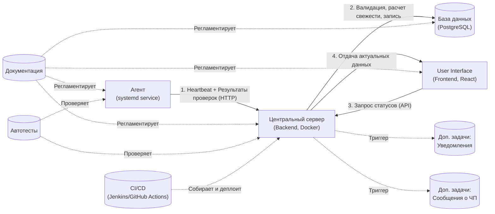

# Архитектура системы мониторинга здоровья сервисов

Этот документ описывает высокоуровневую архитектуру проекта, границы компонентов и потоки данных. Он служит «единым источником истины» для команды разработки.

## 1. Архитектурный стиль

Мы используем подход, при котором **каждый предметный домен выделен в отдельный сервис** (микросервисная архитектура на уровне развертывания и коммуникации), но **внутренняя реализация каждого сервиса представляет собой монолит**. Часто это называют *Bounded Context Monolith* или *Macro-services*.

Это означает:
- Сервисы общаются друг с другом по сети (преимущественно HTTP/REST).
- Каждый сервис имеет свою четкую зону ответственности и может быть развернут независимо.
- Внутри сервиса (например, в Центральном сервере) код организован как классическое монолитное приложение (без излишней дробления на внутренние микросервисы), что упрощает разработку, тестирование и отладку.

## 2. Схема взаимодействия компонентов

## 3. Описание компонентов

### 3.1. Агент (Agent)
- **Роль**: Локальный исполнитель проверок на наблюдаемой машине.
- **Окружение**: Ubuntu Server 24.04 LTS, запускается как `systemd` служба.
- **Ответственность**:
  - Чтение конфигурации (ID машины, токен, список проверок).
  - Выполнение трех типов проверок: `systemd` статус, локальный HTTP, свежесть файла (`touch`).
  - Ограничение времени выполнения каждой проверки (таймауты), чтобы сбой одной проверки не блокировал остальные.
  - **Механизм очереди отправки** (см. раздел 3.5 ниже).
  - Периодическая отправка пакетных результатов на Центральный сервер.
  - Корректная работа при временной недоступности Центрального сервера (пропуск отправки, продолжение локальных проверок).
- **Технологии**: *C# + Bash*.

### 3.2. Центральный сервер (Central Server / Backend)
- **Роль**: Мозг системы, принимающий, обрабатывающий и хранящий данные.
- **Окружение**: Контейнеризация через Docker Compose.
- **Ответственность**:
  - Валидация токена и структуры входящих запросов от Агента.
  - Расчет актуальности (свежести) данных на основе серверного времени получения.
  - Сохранение результатов и истории изменений состояний в БД.
  - Предоставление REST API для User Interface.
- **Технологии**: *C#*.

### 3.3. База данных (Database)
- **Роль**: Постоянное хранение конфигураций, результатов проверок и истории состояний.
- **Окружение**: Отдельный контейнер в Docker Compose (или встроенный, если позволяет ТЗ, но рекомендуется отдельный).
- **Технологии**: PostgreSQL.
- **Ключевая сущность**: Таблица `состояние` (ID_проверки, Тип_результата, Comment, Timestamp).

### 3.4. User Interface (Frontend)
- **Роль**: Визуализация состояния системы для пользователя.
- **Ответственность**: Отображение списка машин, статусов проверок (OK/FAIL/ERROR), индикаторов свежести данных и комментариев к ошибкам.
- **Технологии**: ?.

### 3.5. Механизм очереди отправки (Agent Queue)

Для повышения надежности доставки данных Агент реализует локальную очередь «посылок» (payloads) на случай недоступности Центрального сервера.

#### Принцип работы:
1. После выполнения цикла проверок Агент формирует «посылку» (payload) с результатами и timestamp'ом выполнения.
2. Агент пытается отправить посылку на Центральный сервер.
3. **Если сервер доступен** — посылка отправляется и удаляется из очереди.
4. **Если сервер недоступен** (таймаут, ошибка сети, 5xx) — посылка сохраняется в локальную очередь на диске.
5. При следующем цикле проверок Агент сначала пытается отправить накопленные посылки из очереди (в порядке их создания, FIFO), и только потом отправляет свежие результаты.
6. После успешной отправки посылки удаляются из очереди.

#### Хранение очереди:
- Очередь хранится локально на диске агента (например, в формате JSON-файлов в директории `/var/lib/health-agent/queue/` или в легковесной SQLite БД).
- Каждая посылка содержит:
  - `timestamp` — время выполнения проверок (не время отправки!).
  - `machine_id` — идентификатор машины.
  - `checks` — массив результатов проверок.
  - `attempt_count` — количество попыток отправки (для отладки и возможного ограничения).

#### Ограничения и защита от «раздувания»:
- **Максимальный размер очереди**: *[например, 1000 посылок или 50 МБ]*. При достижении лимита самые старые посылки удаляются (FIFO eviction).
- **Максимальный «возраст» посылки**: *[например, 24 часа]*. Посылки старше этого порога считаются неактуальными и удаляются.
- Эти параметры настраиваются в конфигурации агента.

#### Влияние на Центральный сервер:
- Центральный сервер должен уметь принимать «пачку» исторических результатов с корректными timestamp'ами.
- При обработке таких посылок сервер использует **timestamp из посылки** (время выполнения проверки на агенте), а не время приема, для расчета актуальности данных.
- Это важно для корректного отображения истории и статусов «свежести» в UI.

#### Почему это важно:
- Кратковременные обрывы сети (перезагрузка роутера, временный сбой ЦС) не приводят к потере данных.
- Пользователь видит полную картину, а не «пробелы» в истории.
- Это соответствует принципу «Агент продолжает работать при временной недоступности центрального сервера» из ТЗ, но на более высоком уровне.

## 4. Ключевые архитектурные решения и ограничения

1. **Однонаправленная инициация связи**: Агент сам инициирует соединение с Центральным сервером. Наблюдаемой машине не требуются открытые входящие порты или публичный IP.
2. **Отсутствие тяжелых очередей**: Для MVP не используются брокеры сообщений (RabbitMQ/Kafka). Агент отправляет данные напрямую по HTTP. 
3. **Локальная очередь на Агенте**: Для устойчивости к кратковременным сбоям сети Агент хранит неотправленные посылки локально и отправляет их при восстановлении связи. Это выходит за рамки минимальных требований ТЗ, но повышает надежность системы.
4. **Принцип минимальных привилегий**: Агент не должен требовать прав `root` для всех проверок. Доступ к `systemd` и файлам настраивается через группы или конкретные разрешения (описано в `DEPLOYMENT.md`).
5. **Независимость доменов**: Добавление новой машины или нового типа проверки не требует изменения кода Центрального сервера или перекомпиляции Агента (управляется через конфигурацию).

## 5. Ссылки на смежные документы
- [Логика работы и состояния (OK/FAIL/ERROR, Freshness)](./LOGIC_AND_STATES.md)
- [Контракт API (форматы запросов и ответов)](./API_CONTRACT.md)
- [Руководство по развертыванию](./DEPLOYMENT.md)
