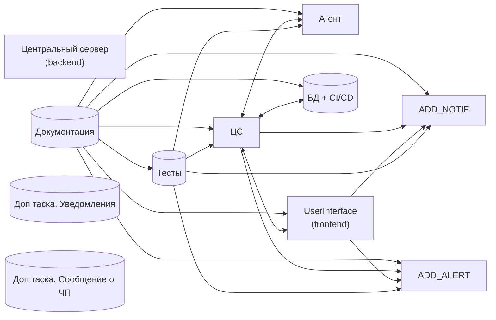

## Домены нашего проекта
| Домен | Ответственный(-ая) |
|---|---|
| 1. Агент (Сервис с использованием Bash) | Фёдор (подмастерье) + Алёна |
| 2. Центральный сервер (Backend) | Савва + Алёна |
| 3. UserInterface (Frontend) | Стас |
| 4. База данных (PostgreSQL) + CI/CD (Docker) | Фёдор(подмастерье) + Лера|
| 5. Тесты | Стас |
| 6. Документация | Алёна |
| 7. Readme | Савва |
| 8. Доп таска. Уведомления | Лера |
| 9. Доп таска. Сообщение о ЧП (ака пролва нескольких проверок подряд) | ---/Алёна(резерв) |
| 10. Заносить хвотсы/ делать тех долг | Алёна |

---

## Наши пожелания / скиллы

| Кто | В каких доменах имею опыт| Какими доменами хочу заниматься | Какими доменами **НЕ ХОЧУ** заниматься|
|---|---|---|---|
| Алена | БД, Агент (bash),  Backend: Центральный сервак (C#, Java, Python и тд), CI/CD (docker)б Тесты | Доки ( -Readme),   БД,   Backend,   Заносить хвосты | Readme, Тесты, Frontend |
| Лера | Frontend,  БД, Агент (bash), Backend (Python) | Front,   Доп таска Уведомления,  CI/CD,   Агент,   Доп таска ЧП | Тесты,   Центральный сервер (но могу) |
| Федор | HTML, Bash| БД,   Агент| Backend (Центральный сервер),   Доки,   Тесты|
| Савва | Python, C#, ООП, учебные приложения. Базовые знания Linux. | Готов взяться за любое направление, разобраться по ходу работы. Пока без конкретных предпочтений. | Тесты как основное направление. |
| Стас | frontend, readme, тесты, все остальное с гпт ток  | frontend, readme, тесты, то что можно сделать с иишкой  | bash, db, ci/cd, заносить хвосты, и все что нельзя сделать с иишкой кроме фронта |

---

## Зависимость доменов

---

---
