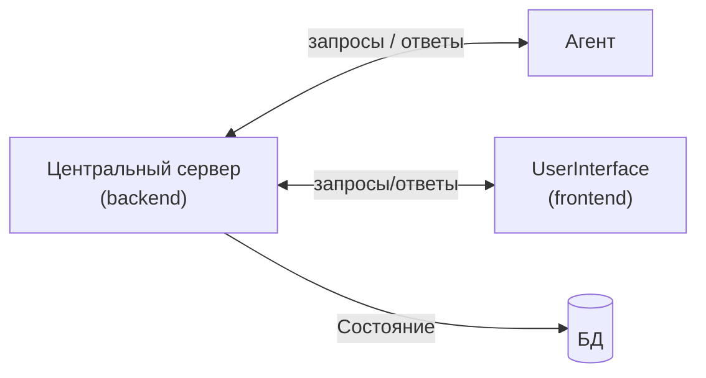

# Основная концепция

Работаем через микросервисы (не монолит)

## Основные сущности

### Агент
---
- (?) systemctl
- (?) HTTP
- (?) touch файлов
---
- get че_происходит?
---

**Обязательную функциональность см. в ["Readme"](README.md)**


### Центральный сервер (Backend)
---
**1.**
- 1.1 Сверка с ожидаемым шаблоном для ответов
- 1.2 Хранение результатов (в БД)
- 1.3 Хранение логов

**2.**
- 2.1 Доступные машины (есть утка вообще?)
- 2.2 Доступные проверки (че утка может?)
- 2.3 Touch файлов (Наверное тут вызов агента)

**3.** Свежесть связи с агентом и создание записи в табличке "состояние" в БД

**4.** Сохраняшка данных перед перезапуском

---

### UserInteface (Frontend)
**1.** Принимает данные от backend и красиво их выводит

### БД

#### **Таблица "Состояние"** 
| ID_проверки | Тип_результата | Comment |
|---|---|---|
| | | если не Ок, то почему |

---

---

### Дополнительыне задачи

| Статус | Задача |
|---|---|
| [ ] | Уведомления |
| [ ] | ЧП |
| [x] | Сделанная задача |

## Ожидаемые сроки выполнения
- 1-3я недели -- Основная часть
- 4я неделя -- Доп задачи или доработка основной части если не успеваем
- 5я неделя -- Доработка кейса и его отладка (без мажорных измененией) 
- 6я неделя подготовка к презентации/защите кейса

```
gantt
    title График выполнения проекта (6 недель)
    dateFormat  YYYY-MM-DD
    axisFormat  %d.%m

    section Основные задачи 
    Документация                  :doc, 2026-11-18, 2026-11-22
    Документация готова           :milestone, m1, 2026-11-22, 0d
    Разработка Backend (ЦентрСерв):backend, 2026-11-23, 2w
    Database + CI/CD (БД + CI/CD) :dbNcicd, 2026-11-23, 2w
    Разработка Агента             :agent, 2026-11-23, 2w
    Разработка UI (Frontend)      :ui, 2026-11-23, 2w
    Базовые Тесты                 :tests, 2026-11-23, 2w
    Основные задачи готоф        :milestone, m2, 2026-12-06, 0d
    
    section Доп. задачи / Доработка
    Доп. задача Уведомления           : add_notif, 2026-12-07, 1w
    Доп. задачи ЧП                    : add_alert, 2026-12-07, 1w
    Доработка основной части (резерв) :fix_main, 2026-12-07, 1w
    Кейс готов                        :milestone, m3, 2026-12-13, 1d

    section Подготовка к презентации
    Подготовка к презентации          :pres, 2026-12-14, 2026-12-20

    section Финал
    Подготовка к защите               :prep,  2026-12-21, 2026-12-24 
    Защита кейса (Milestone)          :milestone, m1, 2026-12-25, 2026-12-26 
```

## Стек для работы
| | Технология|
|---|---|
| БД | PostgresSQL|
| Агент | Bash |
| Центральный сервер (Backend) | ? |
| UserInterface (Frontend) | ? |
| Тесты ||
| CI/CD | Docker |
| Система учета версий | Git |
| Система для формирования задач(?) | Kanban |
